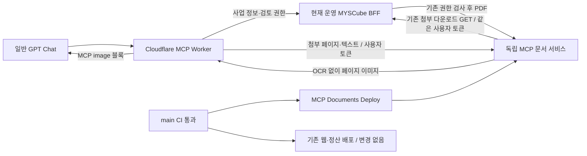

# MCP 문서 처리 배포 분리

## 사용자 결정

- 사용자: “배포부터 분리하자.”
- 원인: MCP PR #925 자체는 일반 웹 배포지만, 운영 이후 미배포 #924 정산 변경과 같은 웹 산출물에 포함되어 원자적 정산 전환 검사에 함께 묶였다.
- 정산 검사 제거, 운영 정산 데이터 수정, main 대신 임의 버전 강제 배포는 해결책으로 채택하지 않는다.
- 새 전용 서비스 생성·비용·문서 처리 범위를 설명한 후 사용자가 “실제로 문서 읽고 판단에 기여했다는거지? 그럼 배포”라고 답했다. 아직 GPT 검증 전임을 정정하고, 사용자가 “그것까지 확인하고 검증해봐 승인”으로 독립 배포 및 실제 GPT 검증을 승인했다.

## 실제 분리 경계

독립되는 것은 **문서 변환 실행 파일과 배포**다. 사업 정보와 파일 접근 권한의 원장은 기존 MYSCube에 남는다. MYSCube 다운로드 API 자체의 가용성까지 독립하는 설계는 아니다.

## 보안·기능 불변 조건

- 문서 서비스는 정해진 4종 대상의 첨부 조회 GET만 제공한다. 임의 URL, 외부 PDF 업로드, 승인·반려·정산 API, Firestore 직접 접근은 없다.
- 전달받은 사용자 토큰으로 기존 다운로드 API를 매번 호출한다. 권한 거절은 그대로 실패하며 캐시·관리자 계정·이전 페이지로 우회하지 않는다.
- 원본과 이미지는 요청 메모리 안에서만 처리한다. 응답은 private/no-store. 리디렉션 금지, 입력 크기 30MB, 페이지 300, JPEG 크기 제한을 유지한다.
- OCR·추론 API 호출과 키는 없다. 기존 글자 레이어 텍스트 조회는 호환용이며 시각 판독은 GPT가 담당한다.
- 서비스 패키지는 렌더러, 제한된 라우트, PDF.js/canvas만 포함한다. 전체 BFF·정산·스케줄러·업무 비밀값을 복제하지 않는다.
- readiness는 합성 PDF의 실제 JPEG 렌더링을 실행한다. HTTP 200이나 워크플로 success만으로 네이티브 의존성이 정상이라고 판단하지 않는다.

## 단계별 활성화

1. 기존 Vercel 팀의 별도 `myscube-mcp-documents` 프로젝트를 사용한다. 최초 생성은 명시적 승인 변수 `MCP_DOCUMENTS_PROVISION_APPROVED=true`, 미지정 프로젝트 ID, 정확한 기본 도메인이 모두 일치할 때만 정상 CI에서 수행한다. 새 API는 사용자 Bearer 토큰과 기존 BFF의 첨부 권한 검사로 보호하며 Vercel 로그인은 요구하지 않는다. 기존 프로젝트의 보호 설정은 수정하지 않는다. 웹 프로젝트 ID 사용은 거절한다.
2. 저장소 변수 `MCP_DOCUMENTS_PROJECT_ID`, `MCP_DOCUMENTS_ORIGIN`을 지정한다. 문서 프로젝트에는 Firebase 서비스 계정·정산·모델 API 키가 필요 없다. 보호된 후보 배포 검사에만 필요하면 `MCP_DOCUMENTS_AUTOMATION_BYPASS_SECRET`을 사용한다.
3. 다음 정상 main CI 이후 `MCP Documents Deploy`가 별도 후보를 생성한다. 실제 렌더 readiness, 잘못된 경로 404, 무토큰 문서 401을 검사한 뒤 전용 도메인만 승격한다. 기존 전용 배포가 있으면 실패 시 해당 배포로 복구한다.
4. 서비스 검증 후에만 저장소 변수 `MCP_DOCUMENTS_ACTIVE_ORIGIN`을 같은 주소로 지정한다. 다음 정상 MCP Worker CI 배포에서 readiness를 재검사하고 첨부 처리 경로만 전환한다. 두 변수를 분리해 서비스 준비 전 Worker 전환 경쟁을 피한다.
5. 일반 GPT에서 실제 계약1·견적2·과업3쪽 수신과 원문 내용 대조를 다시 검증한다. 합성 readiness나 로컬 테스트는 이 합격을 대체하지 않는다.

분리 서비스가 미설정이면 기존 경로를 유지한다. 설정된 서비스의 403이나 장애를 기존 경로로 몰래 폴백하지 않는다. 롤백은 ACTIVE 변수 제거 후 정상 MCP 배포이며, 기존 웹 렌더러가 아직 고장난 상태라면 원문 읽기는 다시 미지원이 된다.

## 현재 상태

- 코드와 회귀 테스트 23개 파일 / 199개 테스트 통과. 문서 서비스·MCP 라우팅·기존 MCP·PDF 패키징 포함.
- 별도 임시 폴더에 허용 파일만 패키징한 뒤 독립 `npm ci`로 4개 패키지만 설치하여 실제 네이티브 렌더 readiness 200 확인. 전체 BFF나 정산 애플리케이션 의존성 없이 실행됐다.
- 이 독립 패키지에서 기존에 권한 있게 확보한 실제 계약1·견적2·과업3쪽 모두 렌더링 및 원본 SHA 일치 확인. 다운로드 함수는 로컬 원본 바이트를 반환하도록 주입했으므로 운영 인증·MCP 전달·일반 GPT 판독 성공으로 집계하지 않는다.
- 전용 프로젝트 생성, 운영 환경 변수 설정, 독립 서비스 배포, GPT 재검증은 아직 미실행.
- Drive 링크의 대용량 파일은 이 서비스가 자동으로 가져오지 않는다. 이번 범위는 MYSCube 인증 첨부 경로다.
